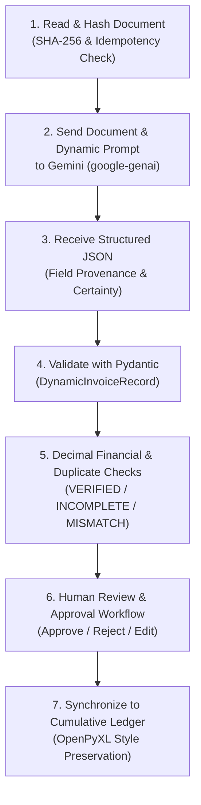

# 🧾 Gemini Invoice Automation Architecture

An intelligent, enterprise-grade invoice automation engine powered by the **Google Gen AI Python SDK (`google-genai`)** with **Gemini Multimodal Document Understanding**.

---

## 🌟 Key Architecture Capabilities

- **Zero Hardcoded Fields (Dynamic Extraction):** Automatically inspects any Excel template (`Book3.xlsx`) at runtime via OpenPyXL to discover sheet names, column headers, inferred types, and number formatting. Constructs Gemini extraction instructions and response schemas dynamically.
- **Configurable Business Rules (`core/business_rules.py`):** Separates company-specific business rules (such as sequencer derivation, accounting month codes, and manual review triggers) from generic template extraction.
- **Multimodal Document Intelligence:** Directly understands native PDF documents, scans, and images (PDF, PNG, JPG, JPEG) without third-party OCR engines, processing tables, itemized descriptions, and multi-page layouts.
- **Recursive Directory Scanning & SHA-256 Idempotency:** Recursively scans directory trees using `pathlib`, computes SHA-256 document checksums, preserves relative paths, and skips previously verified files to conserve API credits.
- **Decimal Financial Cross-Footing:** Performs precision financial calculations using Python `Decimal` arithmetic. Distinguishes `VERIFIED` (balanced within tolerance), `INCOMPLETE` (missing tax, not inferred), and `MISMATCH` (math discrepancy).
- **Two-Tier Duplicate Detection:** Distinctly separates **file-level duplicates** (identical SHA-256 content or path) from **invoice-level duplicates** (matching vendor, invoice number, and amount).
- **Human-in-the-Loop Review Workflow:** Interactive Streamlit dashboard enabling finance teams to preview original documents, edit field values, inspect confidence flags, approve/reject invoices, and synchronize only approved records into a cumulative ledger.
- **Cumulative Ledger Synchronization:** Appends approved records into `output/AP_BLR_Cumulative_Ledger.xlsx` while strictly preserving the pristine master template (`Book3.xlsx`), existing rows, styling, formulas, and currency formatting.
- **Future-Ready Microsoft Graph API:** Modular Outlook client stub for automated mailbox monitoring and attachment extraction.

---

## 🔄 7-Step Processing Pipeline



---

## 📁 Project Structure

```
├── .env                        # API keys, primary model & configuration
├── .env.example                # Example configuration template
├── Book3.xlsx                  # Master Excel template (Sheet: 'AP BLR')
├── samples inv/                # Sample invoice PDFs (18 files)
├── requirements.txt            # Python dependencies (including pytest)
├── run.sh                      # Universal launcher script (all, backend, frontend, test)
├── process_cli.py              # CLI invoice processor
├── core/
│   ├── config.py               # Environment & path configuration
│   ├── models.py               # Pydantic schemas (ExtractedField, DynamicInvoiceRecord, FinancialAudit)
│   ├── business_rules.py       # Configurable business rules for company-specific fields
│   ├── template_engine.py      # Dynamic template inspector & cumulative Excel writer
│   ├── gemini_service.py       # Dedicated Google Gen AI SDK document engine
│   ├── validator.py            # Decimal financial cross-footing & duplicate validator
│   ├── database.py             # SQLite audit trail & safe migrations
│   ├── outlook_service.py      # Microsoft Graph API Outlook integration stub
│   └── pipeline.py             # 7-step pipeline orchestrator
├── backend/
│   └── app.py                  # FastAPI REST API (with review & export endpoints)
├── frontend/
│   └── app.py                  # Streamlit Interactive Review Dashboard
├── tests/                      # Automated Test Suite (21 unit tests)
│   ├── test_template_inspection.py
│   ├── test_dynamic_mapping.py
│   ├── test_financial_validation.py
│   ├── test_date_normalization.py
│   ├── test_duplicate_and_idempotency.py
│   ├── test_folder_scanning.py
│   ├── test_excel_sync.py
│   └── test_gemini_parsing_and_retry.py
└── output/                     # Generated cumulative Excel ledger
```

---

## 🚀 Quick Start

### 1. Installation
```bash
pip install -r requirements.txt
```

### 2. Run Automated Test Suite
```bash
./run.sh test
# or
pytest tests -v
```

### 3. Launch Applications
To run both the **FastAPI backend** and **Streamlit frontend**:
```bash
./run.sh
```

Or run individually:
```bash
# FastAPI backend (http://localhost:8000/docs)
./run.sh backend

# Streamlit frontend (http://localhost:8501)
./run.sh frontend
```

### 4. Process a Single Invoice via CLI
```bash
./process_cli.py "samples inv/NIIN-009131-ARNA TECHNOSOFT LLP-Nailesh R Agrawal.pdf"
```
